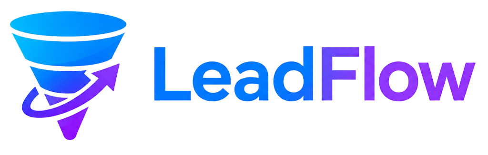

# LeadFlow AI — Autonomous Pipeline & Outbound Engine

<div align="center">



**Transform raw prospect lists into booked sales calls with zero manual intervention.**  
Engineered with enterprise-grade deliverability, autonomous research dossiers, and bespoke multi-channel sequences.

[](https://nextjs.org/)
[](https://react.dev/)
[](https://www.typescriptlang.org/)
[](https://tailwindcss.com/)
[](https://threejs.org/)
[](https://opensource.org/licenses/MIT)

</div>

---

## 📌 Project Overview

**LeadFlow AI** is an intelligent, autonomous outbound sales automation platform designed for modern B2B revenue teams. Most sales pipelines fall behind because revenue reps spend hours manually researching prospects, drafting repetitive cold emails, and juggling multi-channel cadences.

LeadFlow closes that gap by deploying autonomous agents that:
- Ingest raw prospect lists and LinkedIn URLs.
- Synthesize real-time buyer dossiers from keynote talks, job boards, and tech stack milestones.
- Craft context-aware, hyper-personalized multi-channel copy across LinkedIn and Email.
- Coordinate touchpoints into a unified cadence that automatically pauses when a prospect replies.
- Classify inbound prospect intent and book qualified meetings directly into sales calendars.

---

## ⚡ Key Features

- **Autonomous Signal Enrichment**: Cross-references 12+ live data sources to enrich prospect records with verified contact info, professional triggers, and intent signals under strict SOC 2 and GDPR isolation.
- **Hyper-Tailored Personalization**: Replaces static mail-merge tags with deep LLM contextual dossier synthesis. Every outreach email and LinkedIn touchpoint genuinely speaks to the prospect's real initiatives.
- **Synchronized Multi-Channel Touchpoints**: Seamlessly alternates between profile visits, connection requests, personalized InMails, and automated email follow-ups in a natural, spam-free cadence.
- **Reply Intelligence & Intent Classification**: Real-time natural language classifier categorizes prospect responses (meeting requested, objection, referral, OOO) and triggers immediate adaptive cadences.
- **Automated Meeting Booking**: Reconciles team calendar availability, handles scheduling questions via AI, and deposits confirmed appointments straight into Google Calendar, Outlook, and CRM (HubSpot, Salesforce).
- **Interactive 3D WebGL Canvas**: Hardware-accelerated Three.js volumetric tunnel flight in the Hero section, smooth mouse-parallax cursor ring, and concentric rotating 3D core architecture.
- **Scrollytelling Pipeline Engine**: Interactive 4-phase architecture showcase (`[01] Research`, `[02] Personalise`, `[03] Coordinate`, `[04] Progress`) with pinned desktop scrub mechanics and a dedicated natural-scroll view with sticky tab navigation for mobile devices.
- **Apple-Style Standout Metric & Pricing Cards**: High-contrast, clean white cards with elevated ambient shadows, live animated counter meters, and clear tier breakdowns.
- **Interactive Wordmark Paint Reveal**: Custom canvas ink-bleed text reveal in the footer with dynamic cursor tracking and responsive geometry.

---

## 🛠️ Technology Stack

| Layer | Technologies |
| :--- | :--- |
| **Framework** | [Next.js 16 (App Router)](https://nextjs.org/) with React 19 Server & Client Components |
| **Language** | [TypeScript 5](https://www.typescriptlang.org/) (Strict mode, full type-safety) |
| **Styling** | [Tailwind CSS v4](https://tailwindcss.com/) & Vanilla CSS custom variables |
| **3D & Canvas** | [Three.js (WebGL)](https://threejs.org/) with custom procedural shaders, geometry lathes, and particle systems |
| **Animation** | [GSAP 3.15](https://greensock.com/gsap/) (ScrollTrigger) & [Motion (Framer Motion)](https://motion.dev/) |
| **Smooth Scrolling** | [Lenis](https://github.com/darkroomengineering/lenis) smooth-scrolling engine |
| **Icons** | [Phosphor Icons](https://phosphoricons.com/) (`@phosphor-icons/react`) |
| **Typography** | [Geist Sans](https://vercel.com/font/sans) & [Geist Mono](https://vercel.com/font/mono) |

---

## 📂 Project Structure

```text
Leadflow/
├── Leadflow_web/                 # Next.js Application Root
│   ├── public/                   # Static public assets
│   │   ├── logo.png              # Primary LeadFlow brand logo
│   │   ├── leadflow-workflow.png # Architectural flow visual
│   │   └── ...                   # SVG icons and asset graphics
│   ├── src/
│   │   ├── app/                  # Next.js App Router
│   │   │   ├── layout.tsx        # Global RootLayout, font injection, and metadata
│   │   │   ├── page.tsx          # Main Landing Page assemble
│   │   │   ├── globals.css       # Global Tailwind v4 design tokens and CSS rules
│   │   │   └── contact/          # Early access request route (/contact)
│   │   │       └── page.tsx      # Contact & qualification form
│   │   ├── components/           # UI & Feature Components
│   │   │   ├── Navbar.tsx        # Auto-hiding / popping purple glassmorphic navigation
│   │   │   ├── Hero.tsx          # 3D interactive tunnel hero & flight controls
│   │   │   ├── LogoWall.tsx      # Social proof marquee & illuminated facets
│   │   │   ├── Features.tsx      # Comparative benchmark metrics & feature cards
│   │   │   ├── SecurityCompliance.tsx# Enterprise SOC 2 & compliance 3D block
│   │   │   ├── FeatureStory/     # 4-Phase Pipeline Engine (Desktop & Mobile)
│   │   │   ├── HowItWorks.tsx    # Autonomous 4-node architecture
│   │   │   ├── WorkflowFaq.tsx   # 3-step pavilion transition & accordion FAQs
│   │   │   ├── Stats.tsx         # Clean white Apple-style animated metric cards
│   │   │   ├── Testimonials.tsx  # Social proof cards with verified conversion tags
│   │   │   ├── Pricing.tsx       # Transparent Starter, Growth, Enterprise tiers
│   │   │   ├── CTA.tsx           # Dynamic cycling typewriter CTA banner
│   │   │   ├── Footer.tsx        # Editorial footer with interactive wordmark paint
│   │   │   ├── InteractiveTextPaint.tsx # Canvas ink-bleed cursor reveal wordmark
│   │   │   ├── hero3d/           # Procedural 3D tunnel flight engine
│   │   │   └── landing3d/        # Stepped concentric 3D core & shaders
│   │   └── lib/                  # Utilities & helpers
│   ├── netlify.toml              # Netlify deployment configuration
│   ├── next.config.ts            # Next.js compiler & import optimizations
│   ├── package.json              # Dependencies and execution scripts
│   ├── postcss.config.mjs        # PostCSS configuration
│   └── tsconfig.json             # TypeScript compiler configuration
├── .gitignore                    # Root repository ignore rules
└── README.md                     # Project documentation
```

---

## 🚀 Getting Started

### Prerequisites

Ensure you have installed:
- **Node.js**: `v18.17.0` or higher (Recommended: `v20.x`)
- **Package Manager**: `npm` (v9+), `pnpm` (v8+), or `yarn` (v1.22+)

### Installation

1. **Clone the repository**:
   ```bash
   git clone https://github.com/PraveenAIRIZZ/leadflow_website.git
   cd leadflow_website/Leadflow_web
   ```

2. **Install dependencies**:
   ```bash
   npm install
   # or
   pnpm install
   # or
   yarn install
   ```

3. **Start the local development server**:
   ```bash
   npm run dev
   ```

4. **View in browser**:
   Open [http://localhost:3000](http://localhost:3000) to view the application with live hot module replacement.

---

## 🔐 Environment Variables

Create a `.env.local` file in `Leadflow_web/` if you wish to configure optional analytics or external hooks:

```bash
# Example .env.local
NEXT_PUBLIC_APP_URL=http://localhost:3000
NEXT_PUBLIC_SITE_NAME=LeadFlow AI

# Optional: Analytics / CRM webhooks
# NEXT_PUBLIC_ANALYTICS_ID=
# CRM_WEBHOOK_URL=
```

> [!NOTE]
> The landing page and demo interactive 3D simulations run entirely client-side without requiring paid third-party API keys to preview or develop locally.

---

## 🚢 Build & Deployment

### Production Build

To test the production compilation bundle locally:

```bash
cd Leadflow_web

# Build the production bundle
npm run build

# Start the optimized production server
npm run start
```

---

### Deploying to Vercel (Recommended)

1. Push your repository to **GitHub**.
2. Go to [vercel.com](https://vercel.com) and click **"Add New Project"**.
3. Select your GitHub repository (`leadflow_website`).
4. **Important Setting**:
   - In **Project Settings** -> **General** -> **Root Directory**, click **Edit** and set it to:
     ```text
     Leadflow_web
     ```
   - Framework Preset: `Next.js` *(automatically detected)*
   - Build Command: `npm run build`
   - Output Directory: `.next`
5. Click **Deploy**. Vercel will build and assign an automated production URL with global CDN caching.

---

### Deploying to Netlify

The repository includes a ready-to-use [`netlify.toml`](file:///c:/Users/ACER/OneDrive/Documents/Documents/Leadflow/Leadflow_web/netlify.toml) configuration:

```toml
[build]
  command = "npm run build"
  publish = ".next"
```

1. Connect your repository in the [Netlify Dashboard](https://app.netlify.com/).
2. Set the **Base directory** to `Leadflow_web`.
3. Set the **Build command** to `npm run build`.
4. Set the **Publish directory** to `.next`.
5. Install the official `@netlify/plugin-nextjs` plugin if deploying via standard Next.js SSR functions.

---

## 📄 License

This project is licensed under the **MIT License** — see the [LICENSE](LICENSE) file for full details.

---

<div align="center">
  <sub>Built with care for modern B2B revenue teams. Powered by Airizz.</sub>
</div>
